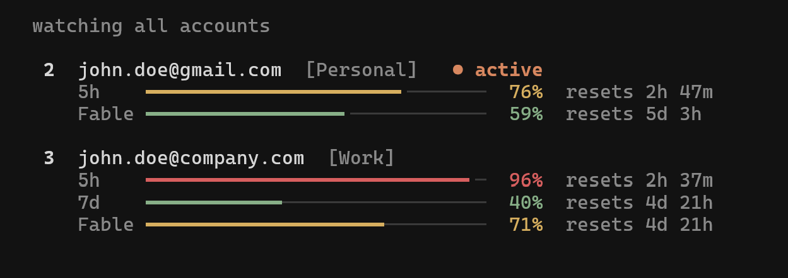

<!-- README rule: say what the user can do, give a minimal example, and mention only caveats that change their decision.
     Mechanics go in docs/, rationale in the PR. When behavior changes, edit the existing text instead of appending. -->

# claude-swap

Multi-account switcher for Claude Code. Easily switch between multiple Claude accounts without logging out, or let it switch for you before you hit a rate limit. Track usage for every account in a live dashboard, and run accounts in parallel. Works with both the Claude Code CLI and the VS Code extension.

## Installation

### Using uv (recommended)

```bash
uv tool install claude-swap
```

### Using pipx

```bash
pipx install claude-swap
```

### From source

```bash
git clone https://github.com/realiti4/claude-swap.git
cd claude-swap
uv sync
uv run cswap help
```

### Updating

```bash
cswap upgrade          # uv/pipx installs on macOS/Linux: auto-detects and upgrades
# or run your installer directly:
uv tool upgrade claude-swap
pipx upgrade claude-swap
```

## Usage

### Add your first account

Log into Claude Code with your first account, then:

```bash
cswap add
```

### Add more accounts

Log in with another account, then:

```bash
cswap add
```

Do not run `/logout` first: current Claude Code may revoke the refresh token stored for the account you are leaving.

### Switch accounts

Rotate to the next account:

```bash
cswap switch
```

Or switch to a specific account:

```bash
cswap switch 2
cswap switch user@example.com
cswap switch dev                # or by alias, once set with `cswap alias 2 dev`
```

Not sure which one? `cswap list` is the dashboard — every account's plan, 5-hour and 7-day usage and reset times at a glance:

```bash
cswap list
```

Or let claude-swap auto-pick by remaining quota — `cswap switch --strategy best` (most quota left) or `--strategy next-available` (skip rate-limited accounts).

**Note:** You usually don't need to restart — on Linux/Windows the new account is picked up automatically, and on macOS after the Keychain cache expires. To apply it instantly, restart Claude Code or reopen the VS Code extension tab. See [Tips](#tips) for the per-platform details.

### Automatic switching

Let claude-swap watch your usage and switch for you. When the active account's 5-hour or 7-day window reaches the threshold (default 90%), it switches to the account with the most quota left — before you hit the limit, and safe to run while Claude Code is working:

```bash
cswap auto                     # foreground loop, polls every 60s
cswap auto --threshold 80      # switch earlier
cswap auto --weekly-threshold 97   # let the weekly window run higher before switching
cswap auto --model Fable       # also switch when the Fable weekly limit is hit
cswap auto --strategy weekly-first   # spend the soonest-expiring weekly quota first (more strategies below)
cswap auto --once              # single check-and-switch, for cron/scripts
cswap auto --dry-run           # log what it would do, never switch
```

<details>
<summary>Strategies, per-account controls & behavior</summary>

**Strategies** (`--strategy`, or `cswap config set autoswitch.strategy`):

| Strategy | Switches | Lands on |
|---|---|---|
| `best` (default) | when the active account reaches its threshold | the account with the most quota left |
| `weekly-first` | same as `best` | the account whose weekly window resets soonest |
| `consume-first` | at the threshold, and earlier whenever an account that resets sooner has room | the account whose weekly window resets soonest |
| `priority-consume-first` | whenever a higher-tier account is usable | your highest tier (`cswap priority`), then the soonest weekly reset |

The weekly ones exist because weekly quota left unused at its reset is lost.

**Per-account controls**

- `cswap disable <num|email>` holds an account out of rotation: auto-switch, bare `cswap switch`, and the `best` / `next-available` strategies skip it until `cswap enable` puts it back. It keeps its login and is still a valid explicit `cswap switch <num|email>` target.
- `cswap threshold <num|email> <pct>` gives one account its own switch-away line (50–99.9) in place of the global one.
- `cswap priority <num|email> <tier>` ranks accounts for `priority-consume-first`: higher tiers (0–1000, default 0) are used first. The other strategies ignore tiers.

**Good to know**

- **Thresholds are switch-away lines, not hard caps.** With nothing under its line, or the active account at its limit, auto-switch still lands somewhere rather than stall. `priority-consume-first` is the exception: it never lands on an account at or over its line, so it holds and keeps polling.
- A cooldown (default 5 min) and a hysteresis margin stop it flip-flopping between accounts near the threshold.
- `--weekly-threshold 97` gives the 7-day and per-model windows their own line, so the weekly budget can run higher than the 5-hour window. `--threshold`, and any per-account threshold, then governs the 5-hour window only.
- `--model Fable` folds that model's weekly limit into the decision, for when you hit a per-model limit before the account-wide ones. Names are the per-model rows in `cswap list` (e.g. `Fable: 100%`), matched case-insensitively.
- Accounts with no 5-hour window (Ultra) are judged on their 7-day and `--model` windows alone.
- If a usage check fails it keeps using the last-known numbers for a limited time while it retries, and an expired token on an idle machine makes it hold rather than fail over.
- An account whose refresh token has died is quarantined and reported until you [re-add it](#refresh-expired-tokens).
- API-key accounts are never rotated onto unless you pass `--include-api-key-accounts`.

For cron/systemd timers, `--once` reports the outcome in its exit code (`0` switched, `1` error, `2` nothing to do, `3` blocked — no viable target), and `--json` emits one JSON event per line:

```bash
*/5 * * * * cswap auto --once --json >> ~/.cswap-auto.log 2>&1
```

Defaults like the threshold and cooldown are configurable with `cswap config set autoswitch.threshold 80` — flags override them (see [Configuration](#configuration)).

</details>

The exact rules (margins, landing, polling cadence, tier handling) are in [docs/auto-switch.md](https://github.com/realiti4/claude-swap/blob/main/docs/auto-switch.md).

### Run multiple accounts at the same time (session mode)

Launch Claude Code as a specific account in the current terminal only — every other terminal and the VS Code extension stay on your default account, so two accounts can work in parallel.

```bash
cswap run 2                     # launch Claude Code as account 2, here only
cswap run user@example.com      # by email
cswap run 2 -- --resume         # everything after '--' is forwarded to claude
cswap run 2 --no-share-history  # keep this account's chat history to itself
```

Sessions use your normal `~/.claude` setup (settings, CLAUDE.md, skills, MCP servers, etc.) and share its chat history, so a conversation started under one account shows up in `--resume` under the others.

<details>
<summary>How it behaves — chat history, MCP servers, tokens</summary>

- **Chat history.** Shared by default: every account reads and writes the history in `~/.claude`. History an account kept on its own before is merged in on its next launch, and nothing already saved is lost (a file that differs on both sides is kept aside in `history-conflicts/` in the backup directory). `cswap config set run.shareHistory false` gives each account its own history; `--no-share-history` does it for one launch.
- **On Windows**, conversations are shared through a directory junction, which needs no special rights; the prompt-history file (`history.jsonl`) is shared only when Windows lets cswap create a symlink (Developer Mode, or an elevated terminal) and otherwise stays per-account.
- **MCP servers.** User-scope MCP servers (`claude mcp add -s user`) are mirrored from your default profile on every launch — manage them there; changes made inside a session don't persist. Definitions are copied as-is (including inline `env`/`headers` values), but MCP OAuth logins are not — HTTP servers may ask you to authenticate once per profile via `/mcp`.
- `--no-share` stops sharing your `~/.claude` setup (settings, skills, etc.) and removes the mirrored MCP config (profiles that never mirrored are left alone). Chat history is separate: it stays shared unless you also pass `--no-share-history`.
- **Your default account.** Running the account that is already your default login launches plain `claude` on that login instead of a session (a second copy of the active credential would go stale). Scripts that need the isolation guaranteed can pass `--require-session`, which refuses instead. When that login holds no usable token any more (missing, or emptied by Claude Code after a failed refresh), the account launches in its session profile from its stored login instead, since plain `claude` would only stop at "Not logged in".
- **Tokens.** A session refreshes its own copy of the account's token; once it exits, the credential it rotated is captured back into the account's stored backup before a switch, swap, move, or usage check uses it. While the session is still running, `cswap switch` refuses to move the default login onto its account if the stored backup has already fallen behind (activating it could only fail) — exit the session first, or pick another account.
- **Usage.** While a session runs, its account's usage is read with the session's own credential, which cswap never refreshes. A read the server refuses shows as token expired, and isn't retried, until the session renews the credential on its next call.

</details>

<details>
<summary>Map accounts to directories — auto-pick per repo</summary>

Bind a directory to an account, and a bare `cswap run` there launches that account in session mode — e.g. work account in work repos, personal elsewhere:

```bash
cswap map 2 ~/work/client-app   # map a directory to account 2
cswap map user@example.com      # map the current directory
cswap map                       # list mappings
cswap unmap ~/work/client-app   # remove one (defaults to current directory)

cd ~/work/client-app/src
cswap run                       # → account 2, session mode
```

Subfolders inherit the nearest mapped ancestor. In an unmapped directory, `cswap run` just launches plain `claude` with your default login. Mappings are per-machine (not part of `cswap export`) and are cleaned up when their account is removed.

</details>

### Interactive dashboard (TUI)

Run `cswap` on its own (or `cswap tui`) for the full-screen dashboard: live usage for every account, switching, and the auto-switcher, all keyboard-driven. `cswap watch` opens it straight to the live monitor. Works on macOS, Linux, and Windows.



### Refresh expired tokens

If an account's token expires, log back into Claude Code with that account and re-run:

```bash
cswap add
```

This will update the stored credentials without creating a duplicate.

If the refresh token itself has died (auto-switch quarantines and reports such an account), log in with it and re-run `cswap add --slot N`, or replace its stored credentials from a known-good export: a plain `cswap import backup.cswap` replaces dead-token slots on its own (a stale export can carry an already-superseded token).

### Other commands

```bash
cswap run 2                     # Run an account in this terminal only (session mode)
cswap auto                      # Auto-switch when nearing rate limits (see above)
cswap config                    # Show or edit settings (see Configuration below)
cswap list                      # Show all accounts with 5h/7d usage and reset times
cswap list --token-status       # Add source-labelled OAuth token diagnostics
cswap status                    # Show current account
cswap add --slot 3              # Add account to a specific slot (prompts before overwrite)
cswap add --alias dev           # Add account and give it a short alias
cswap remove 2                  # Remove an account
cswap disable 2                 # Hold an account out of auto-rotation (keeps its login)
cswap enable 2                  # Return a disabled account to rotation
cswap threshold 2 85            # Switch away from account 2 at 85%, not the global default
cswap threshold 2 --unset       # Return account 2 to the global default
cswap threshold                 # Show the global default and every per-account override
cswap priority 2 100            # Use account 2 before lower tiers (priority-consume-first strategy)
cswap priority 2 --unset        # Return account 2 to tier 0
cswap priority                  # Show every account's tier
cswap alias 2 dev               # Give an account a short alias (usable anywhere NUM|EMAIL is)
cswap alias 2 --unset           # Remove an account's alias
cswap alias                     # List all aliases
cswap move 2 1                  # Assign an account to a slot (relocates to an empty slot, swaps if taken)
cswap swap 2 3                  # Exchange two accounts' slot numbers
cswap unclaimed                 # List stashed credential entries (slot + why they were stashed)
cswap unclaimed --purge ID      # Drop one (deletes its bytes; recover with /login + `cswap add`)
cswap tui                       # Interactive dashboard (also: bare `cswap`)
cswap watch                     # Dashboard, opened on the live watch page
cswap upgrade                   # Upgrade claude-swap to the latest version
cswap purge                     # Remove all claude-swap data
```

The original flag spellings (`cswap --switch`, `cswap --list`, ...) keep working.

## Tips

- **Do you need to restart after switching?** Usually not. On **Linux and Windows**, credentials are stored in a file and Claude Code re-reads them whenever that file changes, so the new account takes effect on your next message — no restart needed. On **macOS**, credentials live in the Keychain, which Claude Code caches for about 30 seconds; a running session picks up the switch once that cache expires. Restart Claude Code (or close and reopen the VS Code extension tab) only if you want the change to apply instantly.
- **Continuing sessions after switching:** You can keep using the same Claude Code session after switching — run `cswap switch` in any terminal and carry on. If you'd prefer a clean start, close and reopen Claude Code (or the VS Code extension tab) and use `--resume` to pick your previous session. Either way, the first message on the new account may use extra usage as its conversation cache rebuilds.

## How it works

- Backs up OAuth tokens and config when you add an account
- Swaps only the account-specific Claude login when you switch accounts;
  live account-independent OAuth state (such as MCP server logins) is
  preserved instead of being overwritten by a slot's older snapshot
- Account credentials stored securely using platform-appropriate methods
- Switches (manual and automatic) hold Claude Code's own credential locks while writing, so a swap never interleaves with a token refresh
- Auto-switch freshens a target's token before activating it, and quarantines accounts whose refresh token has died until you [re-add them](#refresh-expired-tokens)
- Usage numbers refresh every few minutes — faster for an account being used or close to switching, slower for idle ones — keeping cswap comfortably inside Anthropic's rate limits however many dashboards you keep open on a machine. An age note like `· 6m ago` just means the next scheduled check hasn't come yet, not that something is stuck.
- The plan shown after each slot (`· Ultra`, `· Pro`, `· Team`) comes from your account profile and refreshes every six hours, independently of usage; a subscription that has lapsed shows as a highlighted `Free`.

## Data locations

| Platform | Credentials | Config backups |
|----------|-------------|----------------|
| Windows | File-based (inside the backup directory, under `credentials/`) | `~/.claude-swap-backup/` |
| macOS | macOS Keychain | `~/.claude-swap-backup/` |
| Linux / WSL | File-based (inside the backup directory, under `credentials/`) | `${XDG_DATA_HOME:-~/.local/share}/claude-swap/` |

Session-mode profiles (`cswap run`) live under the backup directory in `sessions/`. Tool preferences (`settings.json`) and auto-switch state (`autoswitch_state.json` — cooldown and quarantined accounts; delete it to reset) live in the backup directory root.

On Linux/WSL, set `XDG_DATA_HOME` to override the default location.

## Menu bar (macOS)

<details>
<summary>Optional macOS menu bar app — usage at a glance, click to switch</summary>

Needs the `menubar` extra (macOS only):

```bash
uv tool install 'claude-swap[menubar]'   # or: pipx install 'claude-swap[menubar]'
cswap menubar
```

Shows every account's 5h / 7d / spend usage and switches with a click (specific / rotate / best / next-available), plus the TUI's add / disable-enable / remove / refresh actions. `cswap menubar` hands it to launchd and returns: it keeps running after you close the terminal, comes back at login, and is restarted if it crashes. *Quit* in the menu stops it until the next login; *Settings → Start at login* turns the login start off.

Auto-switching is off until you turn it on, with *Settings → Auto-switch accounts* or `cswap menubar --auto-switch`. It runs the same engine as [`cswap auto`](#automatic-switching) with the same `autoswitch.*` settings, so the menu bar and CLI stay in sync, and the menu's first row shows whether it is running, off, or stopped (click to restart) and when usage was last refreshed.

```bash
cswap menubar --service-status      # running? pid? starts at login? auto-switch on?
cswap menubar --auto-switch         # turn auto-switch on (--no-auto-switch: off)
cswap menubar --uninstall-service   # stop it and remove the LaunchAgent
cswap menubar --foreground          # run attached to this terminal, for debugging
```

`cswap upgrade` restarts a running menu bar when the build changed. The wrapper app in `/Applications`, file locations, environment handling and the Login Items switch are in [docs/menubar.md](https://github.com/realiti4/claude-swap/blob/main/docs/menubar.md).

</details>

## Advanced

### Configuration

Tool preferences live in `settings.json` in the backup root; `cswap config` reads and edits it with validation, so you never have to find the file or guess valid ranges.

<details>
<summary>Commands & usage</summary>

```bash
cswap config                              # list effective settings ("(default)" = not set)
cswap config get autoswitch.threshold
cswap config set autoswitch.threshold 80  # validated: rejects out-of-range values loudly
cswap config set autoswitch.weeklyThreshold 97  # own switch line for the 7-day/per-model windows
cswap config set autoswitch.model Fable   # per-model switching (see "auto"); Fable,Opus for several
cswap config set run.shareHistory false   # each account keeps its own chat history (see "run")
cswap config set updates.check false      # no daily PyPI lookup for the "newer version" hint
cswap config set usage.headerProbe true   # opt in: setup-token usage via a 1-token request (see "add-token")
cswap config unset autoswitch.threshold   # back to the default
cswap config path                         # where settings.json lives
```

`cswap config --help` lists every key with its valid range and default. Hand-editing the file still works — `cswap config` is just a safer front door. `list` and `get` take `--json` for scripting.

</details>

### Backup and migration

Move account data between machines or back it up:

```bash
cswap export backup.cswap                    # All accounts to a file
cswap export backup.cswap --account 2        # One account
cswap export backup.cswap --full             # Include full ~/.claude.json and credential object (same-PC backup)
cswap import backup.cswap                    # Skips accounts that already exist
cswap import backup.cswap --force            # Overwrite existing
```

The export file is plaintext JSON and, by default, carries only each account's own login — machine-shared MCP/plugin OAuth tokens and the device token stay on the source machine (`--full` keeps everything, for same-PC backups). If you need encryption, pipe through your tool of choice (e.g. `cswap export - | gpg -c > backup.gpg`).

If an imported account is the one you're currently logged in as, activate the imported credentials with `cswap switch N --force` (a plain `switch` to the current account is a safe no-op and won't touch the import).

### Share usage readings between machines

Machines that hold the same accounts can end up sharing one usage-endpoint rate limit, so their polling adds up (this is the limit on how often usage can be read, not your subscription quota). `import-usage` lets one machine poll and hand its readings to the others:

```bash
cswap list --json | ssh laptop cswap import-usage - --hold 600
```

<details>
<summary>How it works — matching, holds & when a hold ends</summary>

Machines share that rate limit when they share a login (moved between them with `export`/`import`, so the same token is live on each), or when the account's usage requests are limited per account rather than per token.

The input is `cswap list --json` output. Each row with `usageStatus: "ok"` is matched to a local account by email and organization, and adopted when it is newer than the reading already stored. Its age comes from `usageAgeSeconds`, so the two machines' clocks never have to agree; a script that delays the hand-over should add the delay to that field. `--hold SECONDS` keeps every collector on the receiving machine (`list`, `status`, `auto`, the dashboard, the menu bar) from fetching those accounts for that long, and the held reading stays trusted for switch decisions meanwhile. A hold never runs past the reading's earliest window reset (per-model windows included), nor past an hour after the reading was taken. Renew it with each hand-over, or lift it early with `--hold 0`; when it lapses, the machine goes back to fetching for itself.

</details>

### JSON output for scripting

Add `--json` to `list`, `status`, or `switch` to emit a single machine-readable JSON object on stdout (human-readable notices go to stderr). Useful for scripting auto-swap and quota tracking.

```bash
cswap list --json                   # all accounts with usage/quota
cswap status --json                 # current active account
cswap switch --strategy best --json # switch, then report the result
cswap switch 2 --json
```

<details>
<summary>Example output</summary>

```json
{
  "schemaVersion": 1,
  "activeAccountNumber": 2,
  "accounts": [
    { "number": 2, "email": "you@example.com", "active": true, "usageStatus": "ok",
      "usage": { "fiveHour": { "pct": 25.0, "resetsAt": "2026-06-22T23:29:59Z" },
                 "sevenDay": { "pct": 16.0, "resetsAt": "2026-06-26T17:59:59Z" } } }
  ]
}
```

Every payload carries a `schemaVersion` (currently `1`); on a handled error stdout is `{"schemaVersion":1,"error":{...}}` with a non-zero exit code. `--switch`/`--switch-to` report `{"switched": true|false, "from": …, "to": …, "reason": …}`.

</details>

`cswap auto --json` emits an event *stream* instead — one JSON object per line (`{"schemaVersion":1,"event":"switch","ts":…, …}` with kinds like `poll`, `switch`, `no-switch`, `account-quarantined`, `all-exhausted`, `error`). The contract is additive: new kinds and fields may appear, so scripts should ignore unknown ones.

Every optional field (usage age, last-known usage, fetch errors, pace, login expiry, …) is listed in [docs/json-output.md](https://github.com/realiti4/claude-swap/blob/main/docs/json-output.md).

### Add an account from a raw token or API key

Register a long-lived setup-token (from `claude setup-token`) or a Console API key (`sk-ant-api03-...` workspace key, `sk-ant-usr-...` personal key, or a service-account key) directly, without the browser login — useful on headless servers or when receiving a token from another machine. The token type is auto-detected:

```bash
cswap add-token sk-ant-oat01-...             # OAuth setup-token
cswap add-token sk-ant-api03-...             # API key (any Console key family)
cswap add-token sk-ant-oat01-... --slot 3
cswap add-token - --slot 3                   # read token from stdin
cswap add-token --email user@example.com     # optional label override
```

`--email` is optional; omitted values use `setup-token-{slot}@token.local` (or `api-key-{slot}@token.local` for API keys). No Anthropic API calls are made.

<details>
<summary>Limits — setup-token usage & API-key accounts</summary>

- **Setup-tokens show `usage unavailable` by default**, because the usage endpoint does not answer them (their scope is inference-only). With `cswap config set usage.headerProbe true`, cswap reads their 5h/7d utilization from the rate-limit headers of a 1-output-token Haiku request instead, sent at the normal poll cadence, plus Fable's weekly window from a second 1-output-token Fable request (the headers report a model's own weekly limit only on that model's responses; an account without Fable access just shows no Fable row). Each probe is a real (tiny) request on that account's subscription, which is why it is off by default.
- **What the probe can't do.** Other per-model windows and extra-usage spend are not in those headers. A reading missing the 5h or 7d window (or a window `autoswitch.model` names) is shown but not used for auto-switching. An account the server rejects for quota is marked as at its limit, with no further probe, until the refusal's `Retry-After` passes.
- **API-key accounts.** Any bare `sk-ant-...` value that is not an OAuth token (`sk-ant-oat...`) registers a managed API-key account (the kind Claude Code uses after `/login` with a key). It switches like any other account, but API keys have no subscription quota, so they show no usage and the usage-aware `switch` strategies never skip them as rate-limited. Use keys scoped to a single workspace: a multi-workspace key needs an `anthropic-workspace-id` header on every request, which Claude Code does not add for a stored key.

</details>

**Note:** Third-party providers configured through `ANTHROPIC_BASE_URL`, `ANTHROPIC_API_KEY` or `ANTHROPIC_AUTH_TOKEN` are not managed or switched; those exported variables stay in effect after a switch, so unset them to use the swapped account.

## Documentation

- [docs/auto-switch.md](https://github.com/realiti4/claude-swap/blob/main/docs/auto-switch.md) — the exact auto-switch rules: hysteresis margins, landing rules, per-account thresholds and tiers, polling cadence. Read it to find out why it did or didn't switch.
- [docs/json-output.md](https://github.com/realiti4/claude-swap/blob/main/docs/json-output.md) — every field in `--json` output, including the optional ones. Read it before writing a script against `cswap list --json` or `cswap auto --json`.
- [docs/menubar.md](https://github.com/realiti4/claude-swap/blob/main/docs/menubar.md) — how the macOS menu bar runs under launchd: start at login, the wrapper app in `/Applications`, file locations, upgrades, the Login Items switch. Read it when the icon is missing or the service misbehaves.

`cswap --help` and `cswap <command> --help` document every flag.

## Uninstall

Remove all data:

```bash
cswap purge
```

Then uninstall the tool:

```bash
uv tool uninstall claude-swap
# or
pipx uninstall claude-swap
```

## Requirements

- Python 3.12+
- Claude Code installed and logged in

## License

MIT
