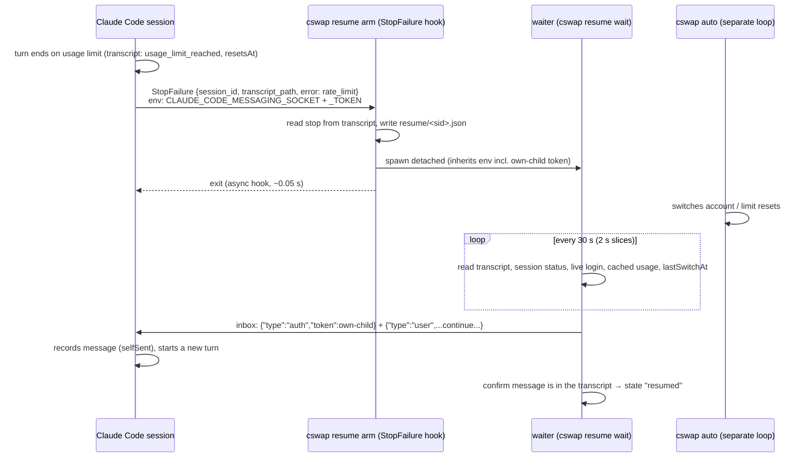

# How claude-swap works — maintainer guide

This guide explains how claude-swap works on the inside, so you can review or
change it later without reverse-engineering the code. It covers two features
in depth:

- [**Pre-warming**](#pre-warming) (`autoswitch.preWarmReserves` /
  `autoswitch.preWarmActive`)
- [**Auto-continue**](#auto-continue) (`cswap resume`)

It also covers the surrounding pieces they rely on. For the user-level "how
do I use it", see [AUTO-CONTINUE.md](./AUTO-CONTINUE.md),
[SETUP.md](./SETUP.md) and [WINDOWS.md](./WINDOWS.md).

---

## 1. Module map

| Module | What it owns |
|---|---|
| `switcher.py` | Accounts, switching, and collecting usage for every account. The core. |
| `credentials.py`, `macos_keychain.py` | Where credentials live: files on Windows/Linux, the Keychain on macOS. |
| `oauth.py` | Token refresh, the usage API, and the pre-warm ping. |
| `usage_store.py` | Cached usage per account (`cache/usage.json`): last good reading, failure backoff, poll schedule. |
| `autoswitch.py` | The `cswap auto` engine: adaptive polling, when and where to switch, quarantine, pre-warm. |
| `settings.py` | `settings.json`, with sections `autoswitch.*` and `resume.*`, validated through `SETTING_SPECS`. |
| `claude_locks.py`, `locking.py` | Claude Code's own lock protocol (respected while swapping credentials), and cswap's file locks. |
| `process_detection.py` | Running Claude Code sessions, read from `~/.claude/sessions/<pid>.json`. |
| `session.py` | `cswap run` profiles (one account per terminal). |
| `transcript.py` | Reads a session transcript's tail: is it stopped on a usage limit, and until when? |
| `inbox.py` | Client for Claude Code's cross-session inbox (socket / named pipe). |
| `hooks.py` | Installs and removes claude-swap's `StopFailure` hook in Claude Code's `settings.json`. |
| `resume.py` | The auto-continue engine: `arm` (hook handler), the readiness policy, the waiter. |
| `resume_cli.py` | `cswap resume install / uninstall / status / now` output and one-shot actions. |
| `cli.py` | Argument parsing and dispatch for every command. |
| `notifications.py` | Desktop notifications (Windows toast, macOS banner, Linux notify-send). |
| `tui/` | The `cswap` / `cswap watch` dashboard. |
| `lines.py`, `poll_policy.py` | (upstream) Per-window switch lines; the usage endpoint's polling cadence and budget. |
| `fsutil.py`, `spawn.py`, `mappings.py`, `launch_agent.py` | (upstream) Atomic writes, process spawning, directory→account mappings, the macOS menu bar service. |

Rows without "(upstream)" either belong to the fork outright or carry fork
insertions; §6 lists exactly which.

---

## 2. Files on disk

The **backup dir** is `~/.claude-swap-backup` on Windows and macOS, and
`$XDG_DATA_HOME/claude-swap` on Linux. `cswap config path` prints where
`settings.json` lives.

| Path | Written by | Contents |
|---|---|---|
| `settings.json` | `cswap config` | User settings, in sections `autoswitch`, `ui`, `run`, `updates` (upstream) and `resume` (fork). |
| `autoswitch_state.json` | auto engine | `lastSwitchAt`, `lastSwitchTo`, `quarantine{}`, and `preWarm{<slot>: {lastPingAt, backoffUntil, consecutiveFailures}}`. The legacy `preWarmed{}` key is unused. |
| `cache/usage.json` | anything that fetches usage | Per-account last good reading, fetch errors, backoff, poll plan. |
| `claude-swap.log` | everything | Rotating log, 1 MB × 3. Auto-continue lines start with `auto-continue:`. |
| `resume/<session-id>.json` | `arm`, waiter, `resume now` | The resume record (see §4.5). |
| `resume/<session-id>.waiter.lock` | waiter | Held for the waiter's lifetime; it's how "only one waiter per session" is enforced. |
| `resume/<session-id>.force` | `cswap resume now` | Tells that session's waiter to go now. |
| `resume/.records.lock` | `arm`, waiter | Serializes read-modify-writes of records. |
| `resume/snapshots/claude-settings.<timestamp>.json` | `resume install/uninstall` | A copy of Claude Code's `settings.json` taken before each change. |

These belong to Claude Code. claude-swap reads them and touches only the
hook entry:

| Path | Used for |
|---|---|
| `~/.claude/settings.json` | The `StopFailure` hook entry (only our entry is ever added or removed). |
| `~/.claude/sessions/<pid>.json` | Live sessions: `sessionId`, `status` (`busy`/`idle`/`waiting`), `messagingSocketPath`, `procStart`, `name`. |
| `~/.claude/sessions/<pid>.<64 hex>.key` | The session's `peerToken`, used to authenticate as an outside peer. |
| `~/.claude/projects/<project>/<session-id>.jsonl` | Session transcript: limit stops, prompts, delivered messages. |
| `~/.claude.json` | `oauthAccount`: which account the live login is. |
| `~/.claude/.credentials.json` | The live OAuth credential (Windows/Linux). |

---

## 3. Pre-warming

### Why

A 5-hour usage window starts on an account's first real message and resets 5
hours later. The usage endpoint is read-only and never starts one. Starting
an idle account's window early, with one tiny real request, makes its reset
land sooner. Once you've drained it, you wait less to loop back to it.

### When it fires

`AutoSwitchEngine._prewarm_idle_accounts` runs on every `cswap auto` tick,
after usage is collected and never in `--dry-run`. An account is pinged only
if **all** of these hold:

1. The matching setting is on: `preWarmReserves` for inactive accounts,
   `preWarmActive` for the live one.
2. It's an OAuth account (API-key accounts have no windows) and isn't
   quarantined. The quarantine check applies to reserves only.
3. Its usage shows **no 5-hour window running** (`_is_truly_idle`): no
   `resets_at` on `five_hour`, and pct ≤ 0. A window that merely reads 0%
   doesn't count.
4. It hasn't been pinged successfully in the last **5 hours**
   (`PREWARM_GUARD_S`).
5. It isn't in failure backoff (`backoffUntil`).
6. No live `cswap run` session owns its token.

### Credential rules

These matter: getting them wrong logs Claude Code out.

| Account | Credential used | Refreshed if expired? | Persisted? |
|---|---|---|---|
| Reserve | Its backup copy in the backup dir | Yes, then saved back to the backup | Yes (backup only) |
| Active | The **live** login (`read_live_credentials`) | **Never.** `try_prewarm_account(is_active=True)` returns `token-expired` without making any request | **Never** |

Why the ping never refreshes the active account: Claude Code owns that
credential, and rotating its refresh-token family outside Claude Code's lock
protocol can log out a running Claude Code. The ping only *uses* the live
token, and only while it is valid.

Keeping that token fresh is the usage poller's job. Since the 2026-11 upstream
sync (v0.30), `switcher._fetch_active_usage` refreshes an expired active token
under Claude Code's own lock protocol (`.oauth_refresh.lock` + `.claude.lock`),
which Claude Code 2.1.218+ adopts. So while `cswap auto` runs, the active
token is normally valid, and active pre-warm can fire overnight too. That is
*inferred from upstream's code and docstring*; not yet observed overnight on
this machine.

### The ping

`oauth.try_prewarm_account` sends `POST https://api.anthropic.com/v1/messages`
with `PREWARM_MODEL` (Haiku 4.5), `max_tokens: 1`, the OAuth bearer token and
`anthropic-beta`. Its cost is negligible.

### Failure handling

A failed ping sets `backoffUntil` (`_prewarm_backoff_s`):

- When the server sends a `Retry-After`, it's honored **in full**.
- Otherwise the wait is exponential: 30 s, doubling up to 600 s.

This exists because of the 2026-08-03 incident: an unguarded retry loop
hammered a burst-blocked account every tick for hours.

### What you see

Each successful ping emits an `account-prewarmed` event `{number, email,
active}`. It shows up in `cswap auto` output and in `--json` streams.

---

## 4. Auto-continue

### 4.1 The problem (measured)

Claude Code's transcripts were scanned for usage-limit stops on 2026-11-02:

- There were about **45 stops in two weeks** across VS Code sessions, often
  6 sessions in the same minute.
- Every one was resumed **by hand** ("carry on pls"), between 25 minutes and
  **27 hours** after the limit had reset.
- Several were resumed right after an account switch, before the old
  account's reset.
- Claude Code's built-in `autoContinueAtUsageLimit` never fired in those VS
  Code sessions (v2.1.301–2.1.314).

### 4.2 Big picture



### 4.3 Components

**`hooks.py` — install / uninstall**
- Adds one entry to Claude Code's `settings.json`: `hooks.StopFailure[] =
  {matcher: "rate_limit", hooks: [{type: command, command: "<python> -m
  claude_swap resume arm", timeout: 30, async: true}]}`.
- The command is the **exact installation running `cswap resume install`**:
  either its launcher, or `sys.executable -m claude_swap`. It's never "first
  `cswap` on PATH", because a machine can have several cswap installs.
- Before every write, the file is copied into `resume/snapshots/`. Only our
  entry is touched, recognized by a command ending in `resume arm` that
  contains `cswap` / `claude_swap` / `claude-swap`.

**`transcript.py` — reading a transcript**
- Reads only the last 512 KB.
- Counts only main-chain turn records: user or assistant, not sidechain, not
  meta.
- A stop is an assistant record with `isApiErrorMessage` plus `apiError:
  "usage_limit_reached"`, or `rate_limit_info.status: "rejected"`, or the
  legacy text `"...limit reached|<epoch>"`.
- The reset time comes from `apiErrorParams.rate_limit_info.resetsAt`, falling
  back to `quotaLimits.resetsAt`.
- Status is `stalled` (last turn record is a stop), `progressed` (real
  assistant output after it), `pending` (a user turn after it with no reply
  yet), or `unknown`.
- Other API errors (overloaded, ...) are skipped: they neither lift a stop nor
  count as progress.
- Peer messages are meta user turns, so they're skipped too. Only the reply
  they provoke moves the state.

**`inbox.py` — delivery**
- Writes newline-delimited JSON to the session's `messagingSocketPath`: a
  named pipe on Windows, a Unix socket elsewhere.
- The first line is `{"type":"auth","token":…}`, required on Windows. Then
  `{"type":"user","message":{"role":"user","content":…}}`.
- On Windows it retries while the pipe is busy (`ERROR_PIPE_BUSY`).
- `peer_token()` reads `<pid>.<hex>.key`, ignoring keys whose `procStartFt`
  doesn't match (a reused PID).

**`resume.py` — `arm`, policy and waiter.** Covered in the sections below.

**`resume_cli.py` — commands**
- `status` joins records with live sessions, and also lists live sessions
  stopped on a limit with no record (e.g. stopped before install).
- `now` either tells a live waiter to go (force flag), or sends directly as
  a peer.

### 4.4 Lifecycle of one stop

```mermaid
stateDiagram-v2
    [*] --> waiting: arm (StopFailure hook)
    waiting --> resumed: ready + idle → posted → confirmed in transcript
    waiting --> undelivered: posted but never recorded (held/refused), or peer-only to a bypass session
    waiting --> gave_up: loop guard (maxConsecutive continues hit the limit again)
    waiting --> moved_on: session produced output after the stop (user / built-in continued it)
    waiting --> session_gone: session process ended or /clear'd
    waiting --> timed_out: waited > 8 days
    waiting --> cancelled: cswap resume cancel
    note right of waiting: sub-states held (older than maxWaitHours) and paused (resume off) never auto-deliver; resume now / on still work
    resumed --> waiting: next limit stop (new arm)
```



How the waiter loop works (`Waiter._loop`):

1. Load the record. Stop unless its state is `waiting`.
2. Check the timeout (`MAX_WAIT_S`, 8 days) and whether the session still
   exists (`find_session`).
3. Read the transcript:
   - Output after the stop (or after arming, if the stop isn't known yet)
     means **moved on**.
   - If no stop shows up within `ARM_GRACE_S` (120 s), the event was about
     something else (a helper query or subagent): also **moved on**.
4. If a *new* stop appears, fold it in with `note_stall`, which applies the
   loop guard.
5. Check readiness (§4.6), or the force flag.
6. Deliver only if:
   - the session status is `idle` or `waiting` (`DELIVERABLE_STATUSES`; the
     terminal UI's limit dialog shows as `waiting`), **and**
   - the transcript still ends on the stop. A session waiting on a
     permission prompt is therefore never poked.
7. Otherwise sleep (2 s slices, watching the force flag) and loop.

### 4.5 The resume record (`resume/<session-id>.json`)

| Field | Meaning |
|---|---|
| `sessionId`, `transcriptPath`, `cwd` | From the hook input. |
| `configHome`, `globalConfigPath` | Where this session's Claude Code config lives (respects `CLAUDE_CONFIG_DIR`). |
| `defaultProfile` | `false` for a `cswap run` profile, where account switches never help. |
| `socketPath` | The inbox address from the hook's environment (a fallback; the live session file wins). |
| `identityEmail`, `identityOrg` | The account the session was on **at the stop**, read when the hook ran. |
| `stallUuid`, `stalledAt`, `resetsAt`, `limitType` | The stop being waited on. |
| `state`, `detail` | Lifecycle state (§4.4) and a human reason. |
| `consecutive`, `lastResumeAt`, `resumedStallUuid` | Loop-guard bookkeeping. |
| `armedAt`, `updatedAt` | Timestamps (epoch seconds). |

**The own-child token is never written to disk.** It lives only in the
waiter's environment, inherited from the hook.

### 4.6 Readiness policy (`evaluate`)

The first rule that matches wins:

| # | Condition | Result |
|---|---|---|
| 1 | `now ≥ resetsAt + resume.slackSeconds` (default 90 s) | **ready**: `limit-reset` |
| 2 | `resume.onSwitch`, default profile, and the live login differs from the one at the stop **or** `lastSwitchAt` is later than the stop | **ready**: `account-switched`, unless cached usage shows the new account's limited window at ≥ 100% (and not yet reset) |
| 3 | Default profile; the live account's cached usage, fetched ≥ 60 s after the stop, shows the limited window ≤ 98% | **ready**: `headroom` |
| 4 | otherwise | wait (≤ 30 s, or until the reset is due) |

Two rules run *before* row 1 and override it:

| # | Condition | Result |
|---|---|---|
| 0a | `resume.maxWaitHours` > 0 and the stop is older than that (default 24 h) | **held**: never auto-delivers; one notification; `resume now` (force flag) still works |
| 0b | `resume.enabled` is false (`cswap resume off`) | **paused**: same, until `cswap resume on` |

Settings are re-read on every pass, so `off`/`on` and config edits apply to
running waiters within one poll. A `cancelled` record (`cswap resume cancel`)
ends the waiter. That is also checked right after the pre-send jitter, so
a cancel that lands in those seconds still wins.

Things to know:
- The waiter never calls the usage API and never switches. It reads
  `cache/usage.json` and `autoswitch_state.json`, which the single `cswap
  auto` loop keeps fresh. Ten stopped sessions therefore add zero API
  traffic.
- "Limited window": `five_hour` or `seven_day`, per the stop's
  `rateLimitType`. For other types, the higher of the two.
- The 90 s slack gives Claude Code's own auto-continue (terminal UI) room to
  act first. If it does, the waiter sees "moved on" and stands down.
- Once ready, the waiter waits a random 0–20 s (`JITTER_S`), so sessions
  stopped on the same limit don't all start in the same second. It then
  re-checks that nobody typed in the meantime.

### 4.7 Loop guard

- When a new stop follows one of our continues with **no** real output and
  **no** human-typed prompt in between, `consecutive` goes up by one.
- Any output or prompt in between resets it to 0.
- At `resume.maxConsecutive` (default 3) the state becomes `gave-up` and a
  notification fires. This stops a session from ping-ponging against a limit
  that isn't really lifting.

### 4.8 Delivery, tokens and confirmation

There are two ways to authenticate to a session's inbox. They behave very
differently in sessions that bypass permission prompts:

| Token | Where it comes from | How Claude Code treats the message |
|---|---|---|
| **Own-child** | `CLAUDE_CODE_MESSAGING_TOKEN`, exported only to that session's hooks and tool commands | As the session's own child (`origin.selfSent: true`). Delivered even in `bypassPermissions`, unless `crossSessionInbound` is `hold`/`refuse`. |
| **Peer** | `peerToken` in `~/.claude/sessions/<pid>.<hex>.key` | As another session. A bypass-mode receiver **holds** it for approval. VS Code can't show that dialog, so it's dropped after `dialogExpiry`, leaving no trace. |

The waiter always uses the own-child token it inherited from the hook. It
uses the peer token only when that doesn't match the session's inbox, and
then **refuses** if the session runs `bypassPermissions` without
`crossSessionInbound: accept`.

**Confirmation.** "Posted" proves nothing, because a held message vanishes.
After posting, the waiter polls the transcript for up to 60 s for our marker
`[claude-swap auto-continue]`. It only counts a **user turn's text**, or a
**queued-command attachment's prompt** (a mid-turn delivery). Assistant
output and tool results don't count: a session that edits cswap itself
quotes the marker in its own tool calls (found live, 20 false matches). A
queued prompt is stored as content blocks, so their text is joined first.

A message that lands while the session is busy (say you typed at the same
moment) is queued, and Claude Code records it only when the turn consumes
it, which can be minutes later. So past 60 s the waiter keeps polling while
the session is `busy` or `waiting`, for up to 30 minutes. Once the session is
idle again with no match, the state becomes `undelivered` and you're notified.
(Found live: a message queued behind a typed "carry on" was recorded after
~70 s and was wrongly flagged `undelivered`.)

### 4.9 Idempotency and concurrency

- **StopFailure fires repeatedly for one limit** (helper queries,
  subagents). Repeated `arm` calls are cheap no-ops:
  - same stop, already resumed → `already-resumed`
  - a waiter is alive → `already-waiting`
  - the session just moved on, and no stop is visible → `recently-moved-on`
    (60 s damping).
- **The hook can run before the stop is flushed to the transcript.** `arm`
  still spawns a waiter, which picks the stop up once it lands (with the
  120 s grace).
- **One waiter per session:** `<sid>.waiter.lock` is a non-blocking lock. A
  second waiter exits at once.
- **Record writes:** `arm` and the waiter both read-modify-write under
  `.records.lock`.
- **The waiter process** is spawned in the background and fully disowned:
  - Windows: `CREATE_NO_WINDOW | CREATE_NEW_PROCESS_GROUP |
    CREATE_BREAKAWAY_FROM_JOB`, falling back to no breakaway if the job
    refuses. Not `DETACHED_PROCESS`: a venv's `Scripts\python.exe` (pipx
    installs) is a launcher that starts the real interpreter as a child, and
    a console program started by a process with *no* console gets a new,
    visible one. That was one empty terminal window per waiting session.
    `CREATE_NO_WINDOW` gives the waiter a console without a window, which the
    interpreter and the toast-notification PowerShell inherit. Toasts also
    pass `CREATE_NO_WINDOW` themselves.
  - POSIX: `start_new_session`.
  - In both cases there's no inherited stdio, so it never holds Claude Code's
    hook pipes open.
- **Pruning:** finished records older than 7 days are removed. Waiting
  records never are.

### 4.10 Claude Code behaviours this relies on

Each row says what breaks, and how to notice, if Claude Code changes it.

| Fact | Since | Source | If it changes |
|---|---|---|---|
| `StopFailure` hook event; matcher = error code (`rate_limit`); output ignored; `async` supported | v2.1.78 | [hooks docs](https://code.claude.com/docs/en/hooks) | `arm` never runs; `cswap resume status` shows nothing after a stop |
| Hooks and tool commands get `CLAUDE_CODE_MESSAGING_SOCKET` and `CLAUDE_CODE_MESSAGING_TOKEN` | v2.1.224 (v2.1.234 on Windows) | [cross-session messaging](https://code.claude.com/docs/en/cross-session-messaging); probed live | waiter falls back to the peer token, so bypass sessions become `undelivered` |
| Inbox wire format: auth line, then user line | same | docs + Claude Code's own `[uds-messaging] Inject messages` recipe | posts fail or are ignored, so `undelivered` |
| Own-child token ⇒ delivered in bypass mode; peer ⇒ held | same | docs; probed live (`selfSent: true`; held peer message left no trace) | bypass sessions become `undelivered` |
| An idle session starts a new turn with an inbox message | same | docs; proven live in a VS Code session | message waits until you type |
| Limit stop = `isApiErrorMessage` + `apiError: usage_limit_reached` + `rate_limit_info.resetsAt` | observed v2.1.301–2.1.314 | user transcripts | stops not detected (waiter stays `waiting` → `moved-on` after grace) |
| Session file `status` ∈ busy/idle/waiting; `waitingFor: "dialog open"` for dialogs | observed v2.1.314 | binary strings | waiter may wait for idle forever (visible as `waiting-for-idle`) |
| Hook edits picked up by running sessions ("file watcher") | — | hooks docs | restart sessions after install |

Known Claude Code gaps worth tracking:
- `StopFailure` doesn't carry the reset time
  ([#97975](https://claudeissues.com/issue/97975-feature-pass-quotalimits-ratelimittype-resetsat-to-the-stopfailure-hook-input)),
  which is why the transcript is read.
- It fires for helper queries and subagents
  ([#91419](https://claudeissues.com/issue/91419-bug-stopfailure-fires-for-internal-helper-queries-and-subagent-failures-on-the-p)),
  which is why `arm` is idempotent and damped.

### 4.11 How it was verified, and how to re-check

All on Windows 11 with Claude Code 2.1.314, 2026-11-02:

| Claim | Evidence | Re-check |
|---|---|---|
| Wire format and pipe | Message posted from a detached process arrived in a live session | `tests/test_inbox.py` posts to a real named pipe / Unix socket |
| Hook gets both env vars; detached child survives the session exit | Probe hook (async + sync) logged both vars; children's 30 s heartbeats ran after the session ended | Recipe A below |
| Own-child token reaches a `bypassPermissions` session; peer token is held | Throwaway `claude -p --permission-mode bypassPermissions` run: the child message was delivered and recorded `selfSent: true`; the peer message, posted while the session was alive, never appeared | Recipe B below |
| Whole production path wakes an idle VS Code session | `cswap resume arm` with a hook-shaped event (synthetic stop), and later `cswap resume test`: waiter waited while the session was busy → delivered once idle → new turn, recorded `selfSent`, confirmed | Recipe C below |
| Installed hook command runs under Claude Code's real hook runner | 3/3 runs: `armed` → `session-gone` | Recipe A, using the installed command |
| Policy, loop guard, waiter loop, idempotency | 60+ unit tests | `uv run pytest tests/test_resume.py tests/test_transcript.py tests/test_hooks.py tests/test_resume_cli.py` |

Not tested yet: the interactive terminal UI's limit dialog, and macOS/Linux.

**Recipe A — fire `StopFailure` without using tokens.** An invalid model
fails with `model_not_found`. Put the hook under that matcher in a
throwaway settings file:

```bash
# probe.json: {"hooks":{"StopFailure":[{"matcher":"model_not_found","hooks":[
#   {"type":"command","command":"<installed hook command>","async":true,"timeout":30}]}]}}
claude -p "hi" --model claude-nonexistent-x --settings probe.json --max-turns 1
grep "auto-continue" ~/.claude-swap-backup/claude-swap.log | tail -2
# expect: "armed session <id>" then "<id> session-gone" (the -p session already exited)
rm ~/.claude-swap-backup/resume/<id>*   # tidy up
```

**Recipe B — own-child vs peer token into a bypass session.**
1. Run `claude -p --permission-mode bypassPermissions --model haiku`.
2. Ask it to run, through its Bash tool, a detached Python process that waits
   a few seconds and then calls
   `claude_swap.inbox.post_message(os.environ["CLAUDE_CODE_MESSAGING_SOCKET"], "PROBE child", os.environ["CLAUDE_CODE_MESSAGING_TOKEN"])`.
3. Ask it to run a second one that uses
   `inbox.peer_token(~/.claude/sessions, <session pid>, <procStart>)` instead.
4. Ask it to sleep, then report which messages it received.
5. Expect only "PROBE child". In its transcript, the child message is an
   attachment with `origin.selfSent: true`, and the peer message is absent.

**Recipe C — wake an idle session through the production path:
`cswap resume test`.** In any chat, ask Claude to "run `cswap resume test`,
then stop". `rehearse()` then:
- finds the calling session from its own inbox env vars;
- writes a stand-in transcript holding one fake usage-limit stop, at
  `resume/<sid>.rehearsal.jsonl`. Claude Code's own files are never written;
- records `rehearsal: true` and `confirmPath` = the real transcript;
- spawns the normal waiter.

The waiter treats a rehearsal as ready at once, with no jitter. It waits
for the turn to end and sends a TEST message ("no task to continue, just
confirm"). It confirms delivery in the **real** transcript.

Expect a new turn in that chat about 10 s after it goes idle, and `cswap
resume status` → `resumed`, `auto-continue test passed`. Verified live
2026-11-02: armed at 22:50:17, delivered and confirmed at 22:50:32.

### 4.11b Review: finished, abandoned and half-done sessions (2026-11-02)

The concern: some sessions are abandoned on purpose, and some stop half-way,
so continuing *everything* is wrong. The review answered it with data, not
heuristics. Every `usage_limit_reached` stop in `~/.claude/projects/*/*.jsonl`
was replayed. The snippet under "Re-measuring the problem" (§7) lists the same
stops; "what you did next" means the first human-origin prompt after the stop.

- **166 stop episodes** (a stop plus its retries), 49 sessions; 143 five-hour,
  23 weekly. 147 of them hit mid-task, after the turn had done work.
- After the stop, the user: came back and said carry on **~82 %**; never touched
  the session again **~8 %** (14, three of them automated test runs);
  redirected **~5 %** (answers to questions, `/model`, new instructions);
  unclear or moved on elsewhere ~5 %.
- **Abandonment is not predictable at stop time.** Batch size (median 5 vs 3,
  overlapping ranges), earlier stops (0 for both) and minutes since the last
  prompt (14 vs 12) don't separate the groups.
- **Rejected:** "a new chat started after the stop in the same folder" →
  1 false block of 127 continued, 0 of 15 abandoned caught.
- **Chosen:**
  - the 24 h hold (0a), which matches Claude Code's own 24 h line for its
    built-in auto-continue;
  - explicit `off` / `cancel`;
  - a continue message that re-checks state and stops if finished, stale or
    waiting on the user. A wrong continue therefore costs one short turn.

Not detectable and therefore not modelled:
- whether a still-open tab is wanted;
- whether a weekly-limit session days later still matters (the hold covers
  this);
- whether the user is at the keyboard.

### 4.12 Troubleshooting

| Symptom | Check |
|---|---|
| A session stopped and nothing happened | `cswap resume status`. No row means `arm` never ran: is the hook installed (`Auto-continue: on`)? Is Claude Code ≥ 2.1.234? Is the hook command still valid after reinstalling Python? Run `cswap resume install` again to re-pin it. |
| Row stuck in `waiting-for-reset` | Expected while no account is free. `cswap auto` must be running for the account-switch trigger to fire. |
| Row `waiting-for-idle (busy)` | The session is mid-turn. It continues once the session goes idle. |
| Row `undelivered` | The session held or refused the message: check `crossSessionInbound`, or it was the peer fallback against a bypass session. Type "continue" there. |
| Row `gave-up` | The loop guard tripped: continues kept hitting the limit. Wait for a real reset, or raise `resume.maxConsecutive`. |
| Row `waiting` · `held` | Stopped longer ago than `resume.maxWaitHours`. `cswap resume now <name>` continues it, `cswap resume cancel <name>` drops it. |
| Row `waiting` · `paused` / header says paused | `cswap resume off` is in effect; `cswap resume on` re-enables. |
| Row `cancelled` | You cancelled it; it won't continue by itself. Type in the session as usual. |
| Need details | `grep "auto-continue" <backup dir>/claude-swap.log` |
| Undo everything | `cswap resume uninstall`. To restore Claude Code's settings exactly, copy the newest file from `resume/snapshots/` back. |

---

## 5. Windows deployment notes (this machine)

- **Two editable installs of this repo are on PATH:** pipx
  (`~/.local/bin/cswap.exe` → `~/pipx/venvs/claude-swap`) and a `pip --user`
  copy under Python 3.13. Both run the repo's code. The hook is pinned to the
  pipx interpreter (`~/pipx/venvs/claude-swap/Scripts/python.exe -m
  claude_swap resume arm`), whose path survives `pipx upgrade`.
- **`cswap auto` runs from Task Scheduler** ("Claude Swap Auto") with an
  **S4U** logon, so it runs outside your desktop session. Two consequences:
  - Its toast notifications may not appear.
  - Its log, `~/.claude-swap-backup/autostart-task.log`, is **UTF-16**
    (PowerShell 5.1 `*>>`), and it can **lag or stall** while the engine keeps
    working. On 2026-11-03 after a sleep/wake, it stopped at 06:27 while the
    engine switched accounts at 06:31. The reliable record is
    `~/.claude-swap-backup/claude-swap.log`: switches, fetch failures and
    auto-continue all go there, written by cswap itself. Check that one
    first.
- **Auto-continue waiters run inside your desktop session** (spawned by
  Claude Code's hook), so they can reach the sessions' `\\.\pipe\LOCAL\…`
  inboxes and show notifications.
- **After changing code**, restart the task. Stopping it kills only its
  PowerShell wrapper; the Python loop exits on its next log write (seconds
  later), so check before starting:
  ```powershell
  Stop-ScheduledTask -TaskName 'Claude Swap Auto'
  Get-Process python, cswap -ErrorAction SilentlyContinue | Where-Object SessionId -eq 0   # wait until empty
  Start-ScheduledTask -TaskName 'Claude Swap Auto'
  ```
  Reopen any `cswap watch` windows to load new dashboard code. Hooks and
  waiters always start fresh, so they need nothing.

---

## 6. Syncing with upstream (realiti4/claude-swap)

This fork tracks [realiti4/claude-swap](https://github.com/realiti4/claude-swap)
through a git remote called `upstream`. The first sync (2026-11-02) brought in
393 upstream commits, going from v0.19 to v0.30.0b1.

**Keep the fork small.** The fork's own code is the files listed under
`[tool.ruff] include` in `pyproject.toml` (auto-continue, notifications, their
tests), plus small, well-marked insertions in upstream files:

| Upstream file | Fork insertion |
|---|---|
| `settings.py` | `pre_warm_*` fields, `ResumeSettings`, the `resume` + pre-warm specs, `PRESETS` / `apply_preset`, `load_resume_settings` |
| `autoswitch.py` | `PREWARM_GUARD_S`, `_prewarm_backoff_s`, `PreWarmEvent`, `_is_truly_idle`, the pre-warm call in `_tick_inner`, `_prewarm_idle_accounts` |
| `oauth.py` | `op` parameter on `_log_usage_failure`; `PingOutcome` + `try_prewarm_account` at the end |
| `switcher.py` | `read_live_credentials`, `cached_usage_entry`, `account_number_for_identity` |
| `process_detection.py` | `messaging_socket_path`, `name`, `proc_start` on `ClaudeSession` |
| `transfer.py` | plaintext-export warning |
| `cli.py` | `auto --notify`, `config apply-preset`, the `resume` group, `add --count` |

**Never reformat upstream files.** Upstream doesn't run ruff. The fork's lint
(CI `lint` job) covers only fork-owned files. Reformatting upstream code was
what turned the first sync into ~200 conflicts in 29 files.

**Next sync, step by step:**

```bash
git fetch upstream
git merge-tree --write-tree --name-only HEAD upstream/main   # preview: conflicted files, nothing written
git merge upstream/main                                      # usually small now
uv sync && uv run pytest && uv run ruff check . && uv run ruff format --check .
```

Resolve any conflict by keeping upstream's code and re-applying the fork
insertion from the table above.

**Windows quirk (confirmed 2026-11-03).** On this machine, every *new* copy
of `scripts/windows/install-autostart.ps1` (a fresh worktree, a temp copy, a
rewrite) is blocked right after it is written, and can't even be deleted
afterwards: Windows reports "the file contains a virus or potentially
unwanted software". The cause is the installed third-party antivirus (not
Defender, whose real-time protection is off here). It treats a script that
registers a hidden, auto-starting PowerShell task as a persistence pattern.
The existing checkout is unaffected.

Consequences:
- don't `git worktree add`, and don't rewrite that script in place;
- use `git merge-tree` or a plain merge in the main checkout;
- clear blocked copies from the antivirus's quarantine.

## 7. Research notes and roadmap

### What the research found (2026-11-02)

- **Cross-session messaging** is a documented, supported way for "a script or
  hook to post into a session". On native Windows it needs an auth line.
  Messages from the session's own children are verified by token
  ([docs](https://code.claude.com/docs/en/cross-session-messaging)).
  Third-party tools such as [cc-peer](https://pypi.org/project/cc-peer/) use
  the same inbox.
- **`StopFailure`** (v2.1.78+) is the right trigger. Its output is ignored, so
  it can't continue the session itself; it can only start something that will
  ([hooks](https://code.claude.com/docs/en/hooks),
  [guide](https://agentpatterns.ai/tool-engineering/stopfailure-hook/)).
- **Built-in `autoContinueAtUsageLimit`** (terminal UI, v2.1.234+) waits for
  the *same* account's reset. It re-arms at most twice, skips resets more than
  24 h away, and didn't fire in VS Code here
  ([write-up](https://wmedia.es/en/tips/claude-code-session-limit-auto-continue),
  [settings](https://code.claude.com/docs/en/settings-reference)).
  claude-swap's advantage: continuing right after an **account switch**,
  across every stopped session at once.
- **Channels** (MCP push into a session) need a development flag during the
  research preview, so they aren't usable for this yet.

### Roadmap (by impact)

1. **Instant switch on a limit stop.** The hook could touch a "tick now" flag
   that the `cswap auto` loop watches, so it switches right away instead of
   waiting for the next poll (up to 15 s). Stops still happen today when a
   burst outruns the poll.
2. **"Use it or lose it" strategy.** Among candidates with headroom, prefer
   the account whose window resets soonest, since its unused quota is lost at
   reset anyway. Today's only strategy, `best`, picks the most headroom.
3. **A readable background log.** Add `cswap auto --log-file` (UTF-8,
   rotating) and use it in `install-autostart.ps1`, replacing the UTF-16
   `*>>`.
4. **An auto-continue panel in `cswap watch`.** Show waiting, continued and
   stopped sessions, with "continue now".
5. **Time-anchored pre-warm.** Ping at a chosen time of day, e.g. 06:00, so
   resets land mid-morning.
6. **Re-check the remaining caveats:** the terminal UI's limit dialog,
   macOS/Linux, and whether toasts from S4U tasks appear.

### Re-measuring the problem

This scans every transcript for usage-limit stops and shows how long each
one sat before it was resumed:

```python
# python measure_stops.py — one line per usage-limit stop, newest sessions included
import glob, json, os
from datetime import UTC, datetime

def records(path):
    for line in open(path, encoding="utf-8", errors="replace"):
        try:
            yield json.loads(line)
        except ValueError:
            pass

for path in glob.glob(os.path.expanduser("~/.claude/projects/*/*.jsonl")):
    recs = list(records(path))
    for i, r in enumerate(recs):
        if r.get("apiError") != "usage_limit_reached":
            continue
        info = (r.get("apiErrorParams") or {}).get("rate_limit_info") or {}
        reset = info.get("resetsAt")
        by_hand = next((x for x in recs[i + 1:]
                        if (x.get("origin") or {}).get("kind") == "human"), None)
        print(os.path.basename(path)[:8], r.get("timestamp"), info.get("rateLimitType"),
              "resets", datetime.fromtimestamp(reset, UTC).isoformat() if reset else "?",
              "| resumed by hand:", by_hand.get("timestamp") if by_hand else "never")
```
